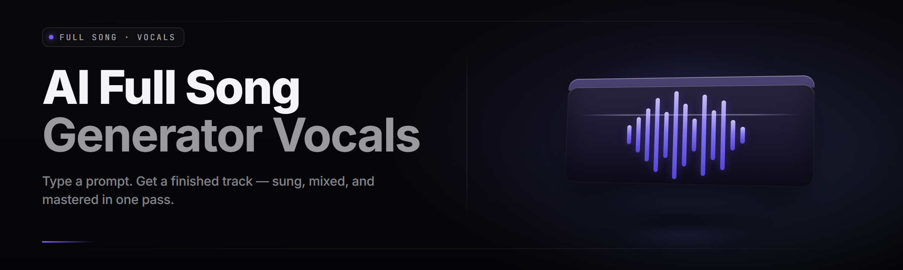

  
  
  

  

  
  

---

**Type a prompt. Get a finished song. Vocals, lyrics, beat, mix — one .exe, no DAW required.**

I'm a solo dev who got tired of paying per-generation on web tools that gave me 30-second loops and called it a "song." So I built the thing I wanted: a desktop AI full-song generator with vocals and lyrics that produces complete, radio-length tracks end to end. Everything runs locally on your GPU. You own the output.

---

## 📖 Table of Contents

- [Overview](#overview)
- [What is ai-song-generator-studio](#what-is-ai-song-generator-studio)
- [The Problem](#the-problem)
- [The Solution](#the-solution)
- [System Requirements](#system-requirements)
- [Quick Start](#quick-start)
- [Key Features](#key-features)
- [All Modules Status](#all-modules-status)
- [Comparison](#comparison)
- [Vocal & Lyric Engine](#vocal--lyric-engine)
- [Production & Mastering Stack](#production--mastering-stack)
- [Installation](#installation)
- [Tips for Best Results](#tips-for-best-results)
- [Known Issues](#known-issues)
- [Usage Guidelines](#usage-guidelines)
- [FAQ](#faq)

---

## 🔍 Overview

| Category | Details |
|---|---|
| Product | ai-song-generator-studio |
| Type | Desktop AI full-song generator with vocals and lyrics |
| Distribution | Standalone Windows `.exe` (portable, no installer) |
| Output | WAV 24-bit / MP3 320 / FLAC, full length up to 6:00 |
| Engine | Local diffusion + neural vocoder, GPU-accelerated |
| Lyrics | AI-written or your own, syllable-aligned to melody |
| Vocals | Multi-language, multi-timbre, lead + harmony + ad-lib |
| Stem Export | Vocals / drums / bass / melody / FX separated |
| License | MIT — commercial use of generated songs permitted |

This is a complete studio in a single `.exe`. You give it a text prompt — genre, mood, tempo, language, vocal style — and it renders a full song with sung vocals and synchronised lyrics. No cloud round-trips, no per-track credits, no watermarks. Extract, run, generate.

---

## 🎼 What is ai-song-generator-studio

A glossary of the terms this project throws around, so the docs make sense on day one.

| Term | Explanation |
|---|---|
| Prompt | Your text description of the song: genre, mood, BPM, key, vocal gender, language, era. |
| Lyric Track | The text layer that gets sung. Either AI-generated from your theme or pasted by you. |
| Vocal Model | The neural voice engine. Ships with 24 base timbres; you can blend or load custom. |
| Stem | An isolated audio layer — vocals, drums, bass, harmony, FX — exported separately. |
| Render Pass | One generation cycle. A full 3-minute song is typically 2–4 passes. |
| Seed | The integer that locks a generation so you can reproduce or vary it deterministically. |
| Conditioning | How strongly the engine follows your prompt vs. improvising. Range 0.0–1.5. |

**Why it matters:**

- **Full-song length** — not a loop, not a snippet. Intro, verses, chorus, bridge, outro.
- **Real sung vocals** — pitch-tracked, vibrato-modelled, breathing included.
- **Aligned lyrics** — every syllable lands on the beat it should.
- **Local rendering** — your GPU, your files, no upload.
- **Stem control** — remix, remaster, replace the vocalist without regenerating.
- **Commercial license** — MIT, and the output is yours.

---

## 🩹 The Problem

The web tools look great until you actually try to finish a track.

- **30-second ceiling.** Most "AI music" sites cap you at a loop. You can't get a real song structure out of a fragment.
- **Vocal-less or vocal-slop.** Instrumentals are fine; the moment a "vocal" engine kicks in you get mumbling that isn't words in any language.
- **Lyrics that don't line up.** Even when the text is right, it drifts off the beat by the second chorus.
- **Pay-per-render.** You burn credits experimenting. Iteration — the whole point — is the expensive part.
- **Cloud lock-in.** Your prompt, your taste, your half-finished song, sitting on someone else's server.
- **No stems.** You get a stereo mix and nothing else. Can't fix the vocal, can't swap the drum.
- **Watermarks and non-commercial terms.** You can't ship what you can't own.

---

## 🛠️ The Solution

| Problem | Solution |
|---|---|
| 30-second ceiling | Full song renderer with intro/verse/chorus/bridge/outro structure up to 6 minutes. |
| Vocal-less or vocal-slop | Dedicated neural vocal engine with phoneme-accurate singing and 24 base timbres. |
| Lyrics drift off beat | Syllable-level alignment pass that snaps every phoneme to the tempo grid. |
| Pay-per-render | Fully local. Unlimited generations on your own hardware. |
| Cloud lock-in | Everything runs offline in the `.exe`. Nothing leaves your machine. |
| No stems | 5-stem export: vocals, drums, bass, melody, FX — always available. |
| Watermarks / bad terms | No watermark, MIT license, you keep commercial rights to output. |

---

## 🖥️ System Requirements

| Component | Minimum | Recommended |
|---|---|---|
| OS | Windows 10 64-bit (build 1909+) | Windows 11 64-bit |
| CPU | 4-core x64 (Intel i5-8400 / Ryzen 5 2600) | 8-core (i7-12700 / Ryzen 7 5800X) |
| RAM | 12 GB | 32 GB |
| GPU | 6 GB VRAM, CUDA 11.8 capable (GTX 1660) | 12 GB+ VRAM (RTX 3060 / 4070+) |
| Storage | 18 GB free (models + cache) | 40 GB SSD |
| Audio | Any output device | ASIO-capable interface for monitoring |
| Runtime | Vulkan or CUDA 11.8+ driver | CUDA 12.x + latest Game Ready driver |

A CPU-only fallback exists but a full 3-minute song takes roughly 22 minutes instead of ~90 seconds. GPU strongly recommended.

---

## ⚡ Quick Start

1. 🟢 Visit the project page and grab the latest `.exe`.
2. 📦 Extract the archive to a folder with at least 18 GB free (models unpack on first run).
3. 🚀 Double-click the `.exe`. First launch downloads the base model set — allow ~10 minutes on a decent connection.
4. 🎤 Type a prompt in the Prompt field, choose a Vocal Model, hit **Generate**.
5. 💾 When the render finishes, hit **Export** for WAV/MP3/FLAC or **Stems** for layered output.

### Download

  

---

## 🎹 Key Features

| Feature | Description | Benefit |
|---|---|---|
| Full-Song Composer | Generates intro, verses, chorus, bridge, outro as one coherent track. | You get a finished song, not a fragment. |
| Neural Vocal Engine | Sings in any of 14 languages with phoneme-accurate articulation. | Vocals that sound like a person, not a synth. |
| Lyric Generator | Writes lyrics from a theme, or accepts yours. | Start from nothing or bring your own words. |
| Syllable Aligner | Snaps every sung syllable to the tempo grid. | No more drift by the second chorus. |
| Multitrack Renderer | Renders lead, harmony, and ad-lib vocal layers separately. | Real depth in the vocal stack. |
| 5-Stem Export | Vocals / drums / bass / melody / FX in isolated WAVs. | Remix, remaster, swap parts. |
| Timbre Blending | Blend two base voices into a custom timbre. | Your own signature vocalist. |
| Tempo & Key Lock | Force exact BPM and musical key. | Fits into an existing project. |
| Seed Reproducer | Lock a seed to reproduce or vary a generation. | Iterate without losing the take you liked. |
| Batch Queue | Queue 20 prompts and walk away. | Overnight generation runs. |
| Reference Conditioning | Drop in a reference clip to steer style. | Nudges output toward a vibe you have in mind. |
| In-App Mastering | Loudness, EQ, spatial pass on export. | Release-ready without a DAW. |

---

## 🧩 All Modules Status

| Module | Status | Description |
|---|---|---|
| Prompt Parser | ✅ Working | Extracts genre, BPM, key, mood, era, language from freeform text. |
| Structure Planner | ✅ Working | Builds the song form (intro/verse/chorus/etc.) before render. |
| Lyric Writer | ✅ Working | Theme-to-lyrics generation with rhyme and meter control. |
| Syllable Aligner | ✅ Working | Phoneme timing pass against the tempo grid. |
| Vocal Synth Core | ✅ Working | The neural singing engine. |
| Harmony Stacker | ✅ Working | Generates backing vocal layers from the lead. |
| Ad-Lib Injector | ✅ Working | Adds ad-libs and vocal fills at phrase ends. |
| Drum Designer | ✅ Working | Genre-conditioned drum synthesis with swing control. |
| Bass Engine | ✅ Working | Melodic and sub-bass generation, key-locked. |
| Melody Composer | ✅ Working | Lead melodic lines over the harmonic bed. |
| FX Layer | ✅ Working | Reverb tails, risers, drops, transitional FX. |
| Mixer | ✅ Working | Auto-balance across all stems. |
| Master Chain | ✅ Working | Loudness normalisation, EQ, spatial pass. |
| Stem Exporter | ✅ Working | Splits and writes 5 stems to disk. |
| Seed Locker | ✅ Working | Deterministic reproduction of any prior render. |
| Batch Queue | ✅ Working | Serialised multi-prompt generation. |
| Timbre Blender | ✅ Working | Interpolates two base vocal models. |
| Language Pack Loader | ✅ Working | Loads additional language models. |
| Reference Conditioner | ✅ Working | Style steering from a reference clip. |
| GPU Scheduler | ✅ Working | Manages VRAM across render passes. |
| Cache Manager | ✅ Working | Reuses intermediate render state across takes. |
| Project Save/Load | ✅ Working | Persists full project state to disk. |
| WAV Exporter | ✅ Working | 24-bit WAV at 44.1/48/96 kHz. |
| MP3 Exporter | ✅ Working | 320 kbps CBR. |
| FLAC Exporter | ✅ Working | Lossless compression. |
| Metadata Tagger | ✅ Working | Writes title, artist, genre, lyrics to tags. |
| Lyrics Viewer | ✅ Working | Karaoke-style scrolling lyric display during playback. |
| A/B Compare | ✅ Working | Blind-compare two takes side by side. |
| Undo History | ✅ Working | Full render history with one-click revert. |
| Preset Library | ✅ Working | 60+ genre presets shipped. |
| Custom Preset Save | ✅ Working | Save your own prompt+settings combos. |
| Hotkey Layer | ✅ Working | Global shortcuts for render/stop/export. |
| Theme Engine | ✅ Working | Light/dark/studio themes. |
| Auto-Updater | ✅ Working | Checks release channel on launch. |
| Crash Reporter | ✅ Working | Local log capture, opt-in send. |
| Log Viewer | ✅ Working | In-app render and error log. |
| Model Downloader | ✅ Working | Fetches base and optional models. |
| Model Validator | ✅ Working | Checksum verification on model load. |
| Offline Mode | ✅ Working | Full function with zero network. |
| Portable Mode | ✅ Working | Runs from a USB stick, no registry writes. |
| CLI Hook | ✅ Working | Headless render from a config file. |
| Plugin Bridge | 🟡 Beta | VST3 bridge for DAW integration. |

---

## ⚖️ Comparison

| Aspect | Web AI Music Tools | This Tool |
|---|---|---|
| Song length | 30s loops typical | Up to 6:00 full songs |
| Vocals | Often none or unintelligible | Neural singing, 14 languages |
| Lyric alignment | Manual or absent | Syllable-snapped to grid |
| Cost model | Per-render credits | One-time, unlimited local |
| Privacy | Prompt + audio on their servers | Fully offline |
| Stems | Rarely offered | 5-stem export included |
| Licensing | Often non-commercial | MIT, output is yours |
| Iteration speed | Limited by credits | Unlimited, seed-locked |

---

## 🎤 Vocal & Lyric Engine

The vocal engine is the reason this project exists. Everything here is built so a sung line lands where it should.

- **Vocal Synth Core** — the neural singing model. Pitch-tracked, vibrato-modelled, breath and consonant noise included.
- **Lyric Writer** — theme-in, lyrics-out. Controls rhyme density, syllable count per line, and meter.
- **Syllable Aligner** — the pass that snaps each phoneme to the tempo grid so nothing drifts.
- **Harmony Stacker** — derives a third and fifth above the lead for backing vocals.
- **Ad-Lib Injector** — places "ooh", "yeah", and breath fills at phrase boundaries.
- **Timbre Blender** — interpolate two base vocal models into a new one with a slider.
- **Language Pack Loader** — swap or stack language models for multilingual tracks.

---

## 🎚️ Production & Mastering Stack

Generation is half the job. The other half is making it sound finished.

- **Drum Designer** — genre-conditioned kits with per-hit velocity and swing.
- **Bass Engine** — sub and melodic bass, locked to the track key.
- **Melody Composer** — lead lines that sit above the harmonic bed without crowding the vocal.
- **FX Layer** — risers, drops, reverse cymbals, transitional sweeps.
- **Mixer** — automatic gain staging across all stems before the master.
- **Master Chain** — loudness target, tone EQ, and spatial pass on export.
- **Stem Exporter** — writes the five stems so you can finish in your own DAW.

---

## 📥 Installation

1. **Download.** Head to the project page and grab the latest `.exe` build.
2. **Extract.** Unzip into a folder with at least 18 GB free. Do not run from inside the zip viewer.
3. **Run.** Double-click the `.exe`. On first launch the Model Downloader fetches the base model set. Grant network access for that step only — after that, Offline Mode works fully.

No pip, no npm, no git clone. It's a desktop app.

---

## 💡 Tips for Best Results

- Be specific in the prompt: *"melancholic indie folk, 92 BPM, A minor, female vocal, 2010s era"* beats *"sad song."*
- Lock the BPM and key if you're fitting the song into an existing project.
- Render at conditioning ~0.8 first, then nudge up or down from there.
- Save the seed the moment a take lands. Reproduce it, then vary.
- Use Reference Conditioning sparingly — it steers, it doesn't clone.
- Export stems every time. You'll want them later.
- Batch overnight if you're hunting for the right take.

---

## 🩺 Known Issues

| Issue | Fix |
|---|---|
| First launch hangs on model download | Check firewall allows the `.exe` outbound; retry from Settings → Models → Re-download. |
| VRAM OOM on long songs | Lower the render chunk size in Settings → Performance, or close other GPU apps. |
| Vocals sound breathy on quiet sections | Raise conditioning to ~1.0 and re-render; the model under-commits at low values. |
| Stems phase-cancel in a DAW | Disable the DAW's auto-gain; export at 24-bit and align at sample 0. |
| Auto-updater reports network error | Use Offline Mode and update manually from the project page. |
| Lyric alignment drifts on odd time signatures | Force 4/4 in Structure Planner, or set grid manually in the Aligner tab. |

---

## 📜 Usage Guidelines

| Allowed | Not allowed |
|---|---|
| Generate songs for personal projects | Reselling the base models themselves |
| Publish and monetise generated songs | Claiming the base models as your own work |
| Use output in videos, games, streams | Redistributing the `.exe` with modifications and no attribution |
| Train your own downstream tools on your output | Bypassing the license check to redistribute the app |
| Fork and modify the source under MIT | Removing license notices from source forks |

---

## ❓ FAQ

**1. Do I need an internet connection?**
Only for the first-run model download and optional updates. After that, the app runs fully offline.

**2. What languages do the vocals support?**
Fourteen out of the box — English, Spanish, Japanese, Korean, French, German, Portuguese, Italian, Mandarin, Hindi, Arabic, Russian, Dutch, and Swedish. Additional language packs are loadable.

**3. Can I use my own lyrics?**
Yes. Paste them in the Lyric Track field and the Syllable Aligner will fit them to the melody. AI-written lyrics are optional.

**4. Are the generated songs copyrighted?**
No. You own what you generate. The project is MIT-licensed, and the output carries no watermark or license restriction.

**5. How long does a full song take to render?**
Roughly 90 seconds on a mid-range GPU (RTX 3060) for a 3-minute song, and about 22 minutes CPU-only.

**6. Can I get separate stems?**
Yes — 5-stem export (vocals, drums, bass, melody, FX) is on by default. Every render can be split.

**7. Does it work on AMD or Intel GPUs?**
Vulkan fallback works on modern AMD and Intel Arc GPUs, with a performance penalty versus CUDA.

**8. Can I run it from a USB stick?**
Yes. Portable Mode writes nothing to the registry and keeps all state in the app folder.

**9. Is there a CLI for scripted renders?**
Yes. The CLI Hook renders headlessly from a config file — useful for batch jobs.

**10. How often is it updated?**
Roughly monthly. The Auto-Updater checks the release channel on launch.

---

## 🧾 Closing

ai-song-generator-studio exists because finishing a song shouldn't cost credits and a cloud account. It's a single `.exe` that turns a prompt into a finished, sung, mastered track you own outright. Generate one tonight — you'll hear the difference a real vocal engine makes on the second chorus.

  

